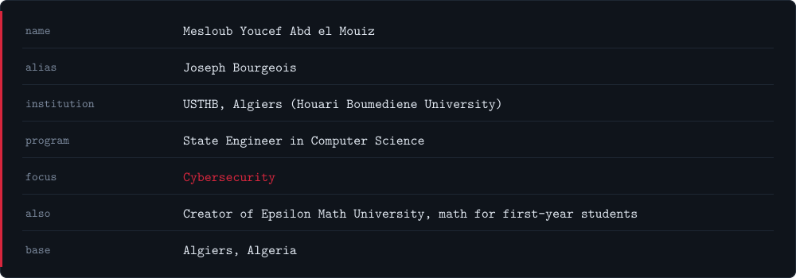
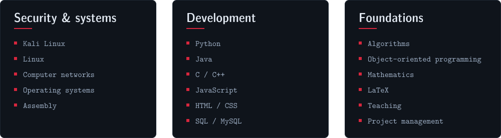
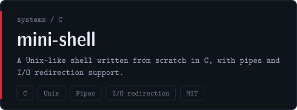
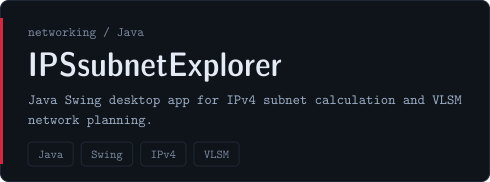
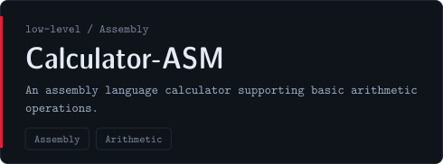
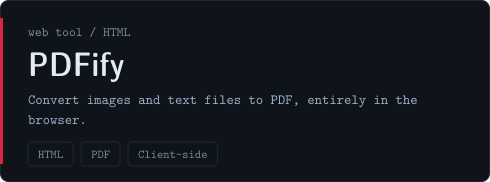

 

<i>Understanding systems down to the metal, so I can understand how they fail.</i>

 

 

 

  
  

  
  

  Also built: <b>Linka</b>, <b>ImageText</b>, <b>.zïp</b>, <b>Vocalo</b> &nbsp;/&nbsp; <a href="https://github.com/xyoucode?tab=repositories">browse all repositories</a>

 

  <picture>
    <source media="(prefers-color-scheme: dark)" srcset="https://raw.githubusercontent.com/xyoucode/xyoucode/output/github-snake-dark.svg">
    <source media="(prefers-color-scheme: light)" srcset="https://raw.githubusercontent.com/xyoucode/xyoucode/output/github-snake.svg">
    
  </picture>

  

 

  <!-- TODO: replace the three placeholder links below with your real ones -->
  <a href="https://github.com/xyoucode">GitHub</a> &nbsp;/&nbsp;
  <a href="https://www.linkedin.com/in/YOUR-LINKEDIN">LinkedIn</a> &nbsp;/&nbsp;
  <a href="https://www.youtube.com/@YOUR-CHANNEL">Epsilon Math University</a> &nbsp;/&nbsp;
  <a href="mailto:YOUR-EMAIL@example.com">Email</a>

